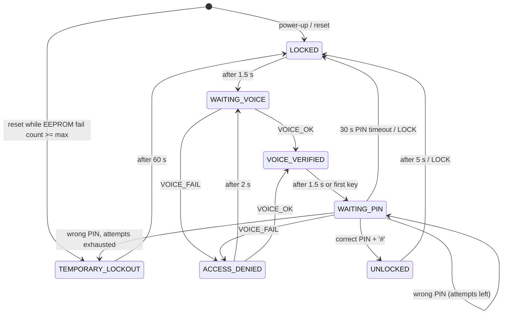

# Smart Door Lock: ATmega32 firmware

This is Stage 2 of the project. It covers the firmware for an ATmega32 (DIP-40) running from an 8 MHz external crystal, built with AVR-GCC.

> **Status:** the code compiles with zero warnings using AVR-GCC 5.4.0 (Atmel Studio 7 toolchain).
> **It has not been tested on hardware yet.** Every hardware result below is a procedure to run, not a result.

---

## 1. File map

| File | Purpose |
|---|---|
| `Headers/config.h` | **The only file you normally edit.** PIN, attempts, timeouts, servo pulses, LCD address, baud, diagnostics switch. |
| `Source/main.c` | Safe startup order, splash screen, watchdog, non-blocking main loop. |
| `Source/authentication.c/.h` | State machine, local PIN check, EEPROM attempt counter, lockout, auto-relock. |
| `Source/protocol.c/.h` | Bluetooth text protocol: line parser and response tokens. |
| `Source/uart.c/.h` | Interrupt-driven USART with RX/TX ring buffers, 9600 8N1. |
| `Source/i2c.c/.h` | TWI master at 100 kHz with timeouts and bus recovery. |
| `Source/lcd_i2c.c/.h` | HD44780 16x2 through a PCF8574, auto-detecting 0x27 or 0x3F. |
| `Source/keypad.c/.h` | 4x4 scan on PORTA, debounce, multi-key rejection. |
| `Source/servo.c/.h` | Timer1 Fast PWM (mode 14) on OC1A, 50 Hz, 1 µs resolution. |
| `Source/timebase.c/.h` | Timer0 CTC 1 ms tick: `millis()`. |
| `Source/diagnostics.c/.h` | Hardware bring-up firmware: I2C scan, keypad echo, servo calibration, UART echo. |
| `SmartDoorLock/SmartDoorLock.atsln/.cproj` | Microchip Studio / Atmel Studio 7 project. Its output goes to `Debug/`. |
| `Makefile` | Command-line build, flash and fuse programming. |
| `Debug/` | Build output (`.elf`, `.hex`, `.map`). |

## 2. Hardware connections (fixed)

| Signal | ATmega32 pin | DIP-40 | Notes |
|---|---|---|---|
| XTAL1 / XTAL2 | XTAL1 / XTAL2 | 12 / 13 | 8 MHz crystal, plus **22 pF from each pin to GND** |
| VCC / AVCC | VCC / AVCC | 10 / 30 | 5 V regulated, **100 nF to GND at each pin** |
| GND | GND | 11, 31 | Common ground for every module |
| RESET | RESET | 9 | **10 kΩ to VCC** (and to the ISP header) |
| HC-05 TXD → | PD0 / RXD | 14 | 3.3 V logic. The AVR needs VIH ≥ 3.0 V, so the margin is only 0.3 V. |
| HC-05 RXD ← | PD1 / TXD | 15 | **Divider: PD1 → 1 kΩ → HC-05 RXD → 2 kΩ → GND** (≈3.33 V) |
| Servo signal | PD5 / OC1A | 19 | Servo power from a **separate 5 V supply**, grounds joined. Put 470–1000 µF across the servo supply. |
| Keypad R1..R4 | PA0..PA3 | 40, 39, 38, 37 | |
| Keypad C1..C4 | PA4..PA7 | 36, 35, 34, 33 | Internal pull-ups are used |
| LCD SCL | PC0 / SCL | 22 | The PCF8574 board normally has pull-ups |
| LCD SDA | PC1 / SDA | 23 | |
| ISP (programming) | PB5 MOSI, PB6 MISO, PB7 SCK, RESET | 6, 7, 8, 9 | For the programmer only |

The parts marked in **bold** (crystal capacitors, decoupling, reset pull-up, divider, servo bulk capacitor) are standard support parts. The firmware assumes they are fitted.

Unused pins (PORTB, PC2..PC7, PD2..PD4, PD6, PD7) are set as inputs with pull-ups in `main.c`.

## 3. Tools and versions

- **Microchip Studio 7** (or Atmel Studio 7.0) with its bundled AVR 8-bit GNU toolchain. The build was checked with `avr-gcc 5.4.0 (AVR_8_bit_GNU_Toolchain_3.6.2_1778)`.
- **avrdude** (6.x or 7.x) for fuses and flashing from the command line.
- An **ISP programmer** (USBasp, AVRISP mkII, Atmel-ICE, etc.). You supply this.

## 4. Build

### Option A: Microchip Studio
1. Open `Firmware/SmartDoorLock/SmartDoorLock.atsln`.
2. Pick **Build → Build Solution** (F7).
3. The output is `Firmware/Debug/SmartDoorLock.hex`.
4. Check that **Project → Properties → Device** says ATmega32 and that `F_CPU=8000000UL` is listed under *Toolchain → AVR/GNU C Compiler → Symbols*.

> **Not verified:** `SmartDoorLock.cproj` was written by hand and has **not** been opened in the Studio GUI. On the development PC, Studio's headless `/build` and plain MSBuild both failed with "Failed to generate the MakeFile". That happens even for Studio's own empty template, so it is a limit of headless builds, not proof the file is wrong.
> If Studio refuses to load the project, recreate it in about two minutes:
> 1. **File → New → Project → GCC C Executable Project**, named `SmartDoorLock`, inside `Firmware/`, device **ATmega32**. Delete the generated `main.c`.
> 2. **Solution Explorer → right-click the project → Add → Existing Item**, select every file in `Source/` and `Headers/`, and choose **Add As Link** from the Add button's arrow.
> 3. **Project → Properties → Toolchain → AVR/GNU C Compiler:**
>    - *Symbols*: add `F_CPU=8000000UL`
>    - *Directories*: add `../../Headers` (relative path)
>    - *Optimization*: `-Os`
>    - *Miscellaneous*: `-std=gnu99`
> 4. **Build → Build Solution.** The HEX is created in the project's `Debug/` folder.

### Option B: Command line (no IDE)
```bash
avr-gcc -mmcu=atmega32 -DF_CPU=8000000UL -IHeaders -Os -std=gnu99 -Wall -Wextra \
  -funsigned-char -funsigned-bitfields -fshort-enums -ffunction-sections -fdata-sections \
  Source/*.c -Wl,--gc-sections -o Debug/SmartDoorLock.elf
avr-objcopy -O ihex -R .eeprom Debug/SmartDoorLock.elf Debug/SmartDoorLock.hex
avr-size -C --mcu=atmega32 Debug/SmartDoorLock.elf
```
Or, if `make` is available: `make`, `make diag`, `make size`.

Measured size of the build in this folder: **5090 bytes flash (15.5 %), 204 bytes RAM (10.0 %)**.

### Diagnostics build
Use `make diag`, or set `ENABLE_DIAGNOSTICS` to `1` in `config.h`. This produces `Debug/SmartDoorLock_diag.hex`.
**Never leave the diagnostics build on a real door.** In that mode the keypad moves the servo freely.

## 5. Clock and fuse configuration

A new ATmega32 ships running from the **internal 1 MHz RC oscillator**, with **JTAG enabled**. The firmware assumes 8 MHz, so the fuses must be changed once.

| Fuse | Value | Meaning |
|---|---|---|
| **LOW** | **0x3F** | CKSEL3..0 = 1111 and SUT1..0 = 11 select the external crystal (3–8 MHz range) with a slow-rising-power start-up delay. BODEN = 0 turns brown-out detection on. BODLEVEL = 0 sets the threshold to 4.0 V. |
| **HIGH** | **0xD1** | JTAGEN = 1 disables JTAG. SPIEN = 0 keeps ISP enabled. CKOPT = 1 (unprogrammed) is fine at 8 MHz. EESAVE = 0 keeps EEPROM (the lockout counter) through a chip erase. Boot settings stay at default. |

Use 0xD9 instead of 0xD1 if you want a chip erase to also clear the EEPROM.

```bash
# read current fuses (factory default is usually L=0xE1 H=0x99)
avrdude -c usbasp -p m32 -U lfuse:r:-:h -U hfuse:r:-:h
# write fuses (-B 10 = slow ISP clock, needed while the chip still runs at 1 MHz)
avrdude -c usbasp -p m32 -B 10 -U lfuse:w:0x3F:m -U hfuse:w:0xD1:m
# flash
avrdude -c usbasp -p m32 -U flash:w:Debug/SmartDoorLock.hex:i
```

Replace `usbasp` with your programmer (`avrispmkII`, `atmelice_isp`, …). In Microchip Studio, use **Tools → Device Programming → Fuses**.

> ⚠ Program the fuses **only after the crystal and its two 22 pF capacitors are fitted**. With CKSEL set to crystal and no crystal present, the chip stops responding to ISP until a clock is supplied to XTAL1.

**How to verify the clock really is 8 MHz:**
1. Read the fuses back. LOW must be 0x3F.
2. Flash the diagnostics build and open a serial terminal at 9600 8N1. If the banner is readable text, the clock is correct. Garbage text means the wrong clock: at 1 MHz the actual baud is 8× too slow.
3. Optional: put an oscilloscope on PD5. You should see a 20.0 ms period. A 160 ms period would mean the chip is still on the 1 MHz internal clock.

## 6. Bluetooth protocol (as implemented)

Settings: 9600 baud, 8N1, no flow control. Every message ends with `\n`. Commands are case-sensitive. A `\r` is ignored, so CRLF also works.

| Android → MCU | Effect |
|---|---|
| `VOICE_OK` | **LOCKED / WAITING_VOICE / ACCESS_DENIED:** start one PIN session. LCD shows VOICE VERIFIED / ENTER PIN. Replies `WAITING_PIN` and starts the 30 s timer. **Session already running:** replies `WAITING_PIN`; the timer and attempts are *not* reset. **UNLOCKED:** replies `UNLOCKED`. **Lockout:** replies `ACCESS_DENIED`. |
| `VOICE_FAIL` | Replies `ACCESS_DENIED`. LCD shows ACCESS DENIED / VOICE REJECTED. Any PIN session is cancelled and the servo stays locked. Ignored while UNLOCKED (replies `UNLOCKED`). |
| `LOCK` | Servo goes to the locked position immediately, the session is cleared, and it replies `LOCKED`. During a lockout the door stays locked and it replies `LOCKED`, but **the lockout is not cancelled**. |
| `STATUS` | Replies with the current status token (mapping below). |
| anything else | Ignored. No reply and no state change. Applies to lines over 16 characters, non-printable bytes and UART errors. |

| MCU → Android | Sent when |
|---|---|
| `LOCKED` | At boot, after a `LOCK` command, at auto-relock, at a PIN timeout, when a lockout ends, and in reply to `STATUS` |
| `WAITING_PIN` | When `VOICE_OK` is accepted, after a wrong PIN once the "TRY AGAIN" message ends, and in reply to `STATUS` |
| `UNLOCKED` | When the correct PIN is entered, and in reply to `STATUS` |
| `ACCESS_DENIED` | On `VOICE_FAIL`, on a wrong PIN, on `VOICE_OK` during lockout, and in reply to `STATUS` during denied or lockout states |

`STATUS` mapping:

| State | Reply |
|---|---|
| LOCKED, WAITING_VOICE | `LOCKED` |
| VOICE_VERIFIED, WAITING_PIN | `WAITING_PIN` |
| UNLOCKED | `UNLOCKED` |
| ACCESS_DENIED, TEMPORARY_LOCKOUT | `ACCESS_DENIED` (no protocol change) |

The PIN is never sent. No command can unlock the door by itself.

## 7. State machine



| Situation | Behaviour |
|---|---|
| **Reset or power loss** | Servo PWM starts at the LOCKED pulse before any other initialisation. A door that was open relocks at power-up. |
| **Bluetooth drops** | The MCU cannot see the link state (the HC-05 STATE pin is not connected). The PIN timeout and auto-relock still run, so the door never stays open or half-authenticated. |
| **Wrong-PIN counter** | Stored in EEPROM as a value plus its complement. Power cycling does not reset it. A corrupted value counts as "max attempts" (fail secure). A correct PIN or the end of a lockout clears it. |
| **Watchdog** | 1 s timeout. If the main loop hangs, the chip resets, comes up locked, and shows `WATCHDOG RESET` on the splash screen. |
| **Bad PIN in `config.h`** | Non-digits or wrong length gives a permanent CONFIG ERROR lockout until the firmware is fixed. |

## 8. Keypad use

Layout: `1 2 3 A / 4 5 6 B / 7 8 9 C / * 0 # D`

| Key | Function |
|---|---|
| `0`–`9` | PIN digits. Shown as `*`. Up to 8 digits. |
| `#` | Enter. Fewer than 4 digits shows PIN TOO SHORT and does not count as an attempt. |
| `*` | Clear the whole entry |
| `A` | Backspace |
| `B` `C` `D` | Unused |

The keypad only does anything in VOICE_VERIFIED and WAITING_PIN. If two keys are pressed together, the input is ignored.

## 9. Servo calibration

The SG90's real angles depend on the unit and on your linkage, so `SERVO_LOCKED_US` = 1000 and `SERVO_UNLOCKED_US` = 2000 are only starting points.

1. Flash the **diagnostics** build. Mechanically **disconnect the servo arm from the bolt**.
2. Open a serial terminal at 9600 8N1.
3. Use keys `4`/`6` (±10 µs) and `7`/`9` (±100 µs) to find the LOCKED pulse. Note the value shown on the LCD or UART.
4. Do the same for the UNLOCKED position. Stay away from the end stops: a buzzing servo is pushing against its stop.
5. Put both values into `config.h`, then rebuild and flash the normal firmware.
6. Reattach the arm in the locked position. Test with `LOCK` and with a correct PIN.

## 10. LCD address detection

- With `LCD_AUTO_DETECT 1` (the default), the firmware tries 0x27 and then 0x3F.
- The diagnostics build prints every I2C device it finds, for example `device at 0x27`.
- If no device is found, check SDA/SCL (they are not swapped), 5 V, GND, and the contrast potentiometer on the backpack.
- If an address answers but the screen is blank, turn the contrast pot.

## 11. Bring-up and firmware test procedures

Fill in **Actual / Pass-Fail** only after doing each test on the real hardware.

| ID | Objective | Steps | Expected | Actual | P/F |
|---|---|---|---|---|---|
| HW-01 | Power | Measure VCC–GND at pins 10/11 and 30/31, and the servo supply under load | 4.75–5.25 V; servo rail does not sag below 4.5 V while moving | | |
| HW-02 | Clock | Fuses L=0x3F H=0xD1; diag build; terminal at 9600 | Readable banner | | |
| HW-03 | I2C / LCD address | Diag build | `device at 0x27` or `0x3F`; LCD shows DIAGNOSTICS | | |
| HW-04 | Keypad | Diag build; press all 16 keys | Each key reported correctly, once per press | | |
| HW-05 | UART | Diag build; send `hello\n` from the terminal | `RX:hello` | | |
| HW-06 | HC-05 pairing | Pair the phone with the HC-05 (PIN 1234 or 0000 unless changed) | Phone lists it as paired | | |
| HW-07 | RFCOMM | Connect with a "Serial Bluetooth Terminal" app (Classic SPP) | HC-05 LED changes to the connected pattern; HW-05 works over Bluetooth | | |
| HW-08 | Servo PWM | Diag keys 1/3/5; scope on PD5 if available | 50 Hz; servo moves to each position | | |
| FW-01 | Safe start | Flash normal build; power up | WELCOME, then DOOR LOCKED, then WAITING VOICE; `LOCKED` received; servo at locked | | |
| FW-02 | VOICE_OK | Send `VOICE_OK` | `WAITING_PIN`; LCD shows VOICE VERIFIED, then ENTER PIN: | | |
| FW-03 | Correct PIN | FW-02, then `1234#` | `UNLOCKED`; ACCESS GRANTED; servo unlocks; after 5 s `LOCKED` and servo relocks | | |
| FW-04 | Wrong PIN | FW-02, then `9999#` | `ACCESS_DENIED`; WRONG PIN / TRY AGAIN; then `WAITING_PIN`; servo stays locked | | |
| FW-05 | Lockout | 3 wrong PINs | SYSTEM LOCKED with countdown; `VOICE_OK` → `ACCESS_DENIED` | | |
| FW-06 | Lockout survives reset | During FW-05, press reset or cycle power | Comes back in SYSTEM LOCKED | | |
| FW-07 | VOICE_FAIL | Send `VOICE_FAIL` | `ACCESS_DENIED`; ACCESS DENIED; keypad ignored | | |
| FW-08 | LOCK | During UNLOCKED, send `LOCK` | Servo locks immediately; `LOCKED` | | |
| FW-09 | STATUS | Send `STATUS` in each state | Matches the table in section 6 | | |
| FW-10 | Invalid command | Send `voice_ok`, `VOICE_OKK`, a 40-character line | No reply; state unchanged | | |
| FW-11 | Split packets | Send `VOI`, wait 1 s, send `CE_OK\n` | Accepted as `VOICE_OK` | | |
| FW-12 | PIN timeout | FW-02, then wait 30 s | `LOCKED`; PIN TIMEOUT | | |
| FW-13 | BT disconnect | FW-02, then disconnect the phone | Still times out to LOCKED; never unlocks | | |
| FW-14 | No unlock without PIN | Send any sequence of commands only | Servo never unlocks | | |
| FW-15 | Power reset while unlocked | During UNLOCKED, cycle power | Servo returns to locked at boot | | |

## 12. HC-05 notes

- The default data-mode baud is usually 9600. Some modules ship at 38400. If text arrives garbled, check it in AT mode: hold the button or pull KEY/EN high at power-up, use 38400 8N1, and send `AT+UART?`. Set it with `AT+UART=9600,0,0`.
- **Change the default pairing PIN.** `VOICE_OK` is plain text, so anyone who can pair with the HC-05 can start the PIN stage. They still need the physical keypad PIN, but the pairing PIN is the only barrier on the Bluetooth link. Use `AT+PSWD=xxxx` (or `AT+PSWD="xxxx"` on newer firmware) and `AT+NAME=...`.
- AT commands need a USB-UART adapter or a temporary terminal sketch. They are not part of this firmware.

## 13. Optional hardening
- **Lock bits:** stop the PIN being read out of flash with `-U lock:w:0xFC:m`. You can still reflash after a chip erase.
- Change `AUTH_PIN_CODE` before installation. The default `1234` is for testing only.
