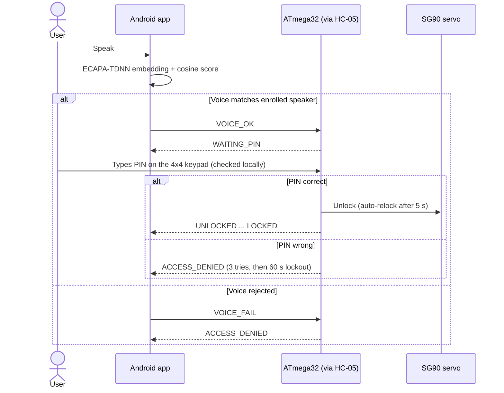

# 🔐 Smart Door Lock: AI Speaker Verification + Keypad PIN

**Two-factor door lock.** An Android app checks *who* is speaking with an **ECAPA-TDNN** deep-learning model, then an **ATmega32** lets the user in only after the correct **PIN** is typed on a physical keypad. The PIN never leaves the lock.


-0082FC)


---

## ✨ How it works



1. **Stage 1: voice.** The app records the user and runs speaker verification on the phone. It sends `VOICE_OK` or `VOICE_FAIL` over Bluetooth Classic.
2. **Stage 2: PIN.** Only after `VOICE_OK` does the keypad accept a PIN. The ATmega32 checks it locally and drives the servo.
3. **Fail-secure.** The door starts locked at every power-up. No Bluetooth command can unlock it alone. The wrong-PIN counter survives resets (it is kept in EEPROM).

## 🧩 Hardware

| Part | Connection (ATmega32 DIP-40) |
|---|---|
| ATmega32 + 8 MHz crystal | XTAL1/XTAL2 (pins 12/13) |
| HC-05 Bluetooth Classic | TXD → PD0 (14), RXD ← PD1 (15) through a 1k/2k divider |
| SG90 servo | Signal ← PD5/OC1A (19), separate 5 V supply, common GND |
| 4x4 keypad | Rows PA0–PA3 (40–37), columns PA4–PA7 (36–33) |
| 16x2 LCD + PCF8574 (I2C) | SCL PC0 (22), SDA PC1 (23); address 0x27 or 0x3F (auto-detected) |

The full wiring, fuses (L=`0x3F`, H=`0xD1`) and bring-up tests are in [Firmware/README.md](Firmware/README.md).

## 📡 Bluetooth protocol

Plain ASCII; every line ends with `\n`.

| Android → ATmega32 | ATmega32 → Android |
|---|---|
| `VOICE_OK` · `VOICE_FAIL` · `LOCK` · `STATUS` | `LOCKED` · `WAITING_PIN` · `UNLOCKED` · `ACCESS_DENIED` |

## 📁 Repository layout

```
Smart_Door_Lock/
├── Firmware/          ATmega32 firmware (Embedded C, AVR-GCC, Microchip Studio project, Makefile)
│   ├── Source/        main, authentication state machine, protocol, uart, i2c, lcd, keypad, servo
│   ├── Headers/       config.h  ← PIN, timeouts, servo pulses, LCD address
│   └── SmartDoorLock/ Microchip Studio solution
├── Android/           Android Studio project (Kotlin, Compose, Material 3)
│   ├── app/           UI: main screen, Bluetooth screen, voice screen
│   └── bluetooth/     Bluetooth Classic SPP / RFCOMM library + unit tests
├── AI_Model/          (Stage 4) ECAPA-TDNN export, validation and threshold calibration
└── Documentation/     (Stage 7) report, diagrams, test results
```

## 🚀 Quick start

**Firmware**
```bash
cd Firmware
make                       # → Debug/SmartDoorLock.hex  (or open SmartDoorLock/SmartDoorLock.atsln)
make fuses && make flash   # USBasp by default: PROGRAMMER=avrispmkII etc.
```

**Android:** open `Android/` in Android Studio, then **Run** on a real phone. The emulator has no Bluetooth Classic.

## 🛠 Tech stack

| Area | Tools |
|---|---|
| Firmware | AVR-GCC 5.4, avr-libc, Timer1 Fast PWM, TWI/I2C, interrupt-driven UART, watchdog, EEPROM |
| Android | Kotlin 2.4, Jetpack Compose (BOM 2026.09), Coroutines/Flow, AGP 9.5, Gradle 9.9, SDK 37 |
| AI (Stage 4) | SpeechBrain ECAPA-TDNN → ONNX → ONNX Runtime Android, cosine scoring, FAR/FRR calibration |

## 📍 Project status

| Stage | Content | Status |
|---|---|---|
| 1 | Requirements and architecture | ✅ Done |
| 2 | ATmega32 firmware | ✅ Compiles with 0 warnings (5.1 KB flash), ⏳ not yet tested on hardware |
| 3 | Android app + Bluetooth Classic | ✅ Builds, lint clean, unit tests pass, UI checked on an emulator, ⏳ not yet tested with HC-05 |
| 4 | ECAPA-TDNN / ONNX Runtime | 🔜 Next |
| 5 | End-to-end integration | 🔜 |
| 6 | Integration tests on hardware | 🔜 |
| 7 | Documentation and technical report | 🔜 |

> Nothing in this repository is claimed as hardware-tested until the test tables in each README are filled in with real results.

## 🔒 Security notes

- The **keypad PIN is checked only on the ATmega32** and is never sent over Bluetooth.
- Change the default PIN in `Firmware/Headers/config.h` (`1234` is for testing only). Also change the **HC-05 pairing PIN**, since `VOICE_OK` is plain text.
- Speaker verification alone can be fooled by a recording, which is why the physical PIN is the second factor.
- Voice data stays on the phone. It is excluded from Android backup and, from Stage 4, encrypted with an Android Keystore key.

## 📄 License

Released under the [MIT License](LICENSE). The ECAPA-TDNN model weights added in Stage 4 come from a third party and keep their own license.
